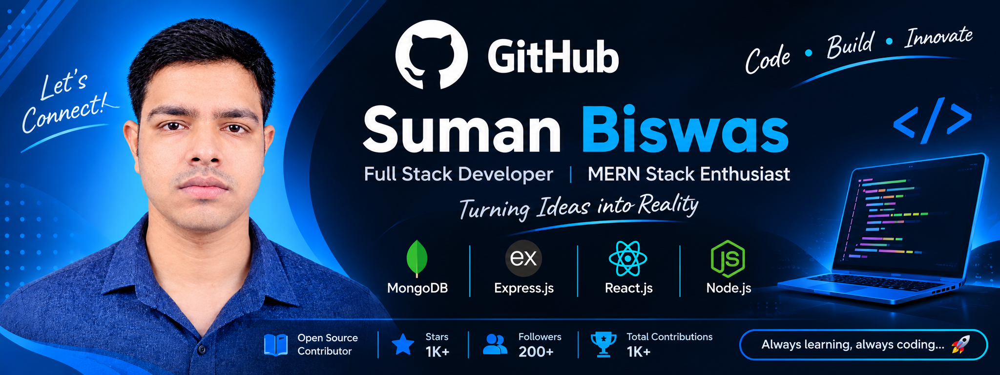

  

# 👋 Hi, I'm Suman Biswas

### 🚀 Full Stack Web Developer | MERN Stack Enthusiast

I am a passionate Full Stack Web Developer who loves building modern, responsive, and scalable web applications. I enjoy solving real-world problems through clean code, creative thinking, and modern technologies.

---

## 👨‍💻 About Me

- 🔭 Currently working on: **Full Stack Web Applications**
- 🌱 Currently learning: **Next.js, TypeScript & Advanced Backend Development**
- 🧠 Core Focus: **MERN Stack, REST APIs, Next.js & Modern Web Technologies**
- 💡 Interested in: **AI Integration, Clean Architecture & Problem Solving**
- 🤝 Looking to collaborate on: **Open Source & Full Stack Projects**
- 💬 Ask me about: **React.js, Node.js, Express.js, MongoDB & MERN Stack**
- ⚡ Fun fact: **I love turning ideas into real-world applications.**

---

## 🛠️ Tech Stack & Tools

**Frontend**
- HTML5, CSS3, JavaScript, TypeScript
- React.js, Next.js
- Tailwind CSS

**Backend**
- Node.js, Express.js
- REST API

**Database**
- MongoDB
- Mongoose

**Tools**
- Git, GitHub
- VS Code
- Postman
- Figma

---

## 📊 GitHub Statistics

  
  

  

---

## 🤝 Connect With Me

  

---

### 💫 My Goal

**Keep Learning | Keep Building | Keep Growing 🚀**

⭐ Thanks for visiting my profile!

